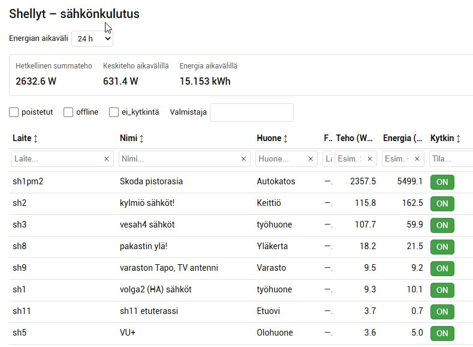

# Shelly Table Card

A custom Home Assistant dashboard card for listing Shelly devices, monitoring
their power and energy, and controlling switches. A manufacturer filter also
allows devices from other manufacturers to be displayed.



## Features

- Shows devices in a sortable table with name, area, power, energy and switch
  state.
- Filters by manufacturer and table columns using regular expressions. Power
  and energy filters also support comparisons such as `>100` and `<=0.5`.
- Shows the total current power of the displayed devices. For a selected
  period, it also calculates total energy and average power from Home Assistant
  history.
- Opens entity history from the power and energy values.
- Opens device details, including entities, their states and copyable entity
  IDs and YAML examples.
- Controls `switch` and `light` entities. A device whose user-assigned name
  contains `!` requires confirmation before changing the switch state.

## Manual installation

1. Copy `shelly-table-card.js` to Home Assistant's
   `/config/www/shelly-table-card/shelly-table-card.js`, creating the
   `shelly-table-card` directory if necessary.
2. In Home Assistant, open **Settings → Dashboards → Resources** and add
   `/local/shelly-table-card/shelly-table-card.js` as a **JavaScript module**.
   If Resources is not visible, enable Advanced Mode in your user profile. If
   you already registered the card at a different URL, update the existing
   resource instead of adding it twice.
3. Add a manual card to a dashboard:

   ```yaml
   type: custom:shelly-table-card
   title: Shellyt – sähkönkulutus
   manufacturer: shelly
   ```

## HACS

The repository is structured for HACS as a custom Dashboard repository.
After the files have been published on GitHub, add
`https://github.com/vesal/shelly-table-card` as a custom repository in HACS,
select **Dashboard**, and download it. Follow the resource instructions shown
by HACS, then add the card using the YAML above. Use either the HACS-managed
resource or the manual resource, not both.

## Configuration

The `title` and `manufacturer` settings are optional. The manufacturer
defaults to `Shelly` and is a case-insensitive regular expression. Change the
manufacturer field on the card to show other devices; an empty field matches
all manufacturers. The manufacturer filter and energy period are remembered
in the browser.

## Usage and limitations

The creadne tiedostoon voisi lisätä esimerkiksi:
- The card reads the Home Assistant device, entity and area registries and uses
the current entity states. It needs access to those registries. By default it
filters out devices without usable entities, devices whose relevant entities
are all unavailable, and devices without a switch, power or energy entity.
The checkboxes above the table allow these devices to be included.

For each device, the card selects one power entity, one energy entity and one
control entity when available. It prefers a `switch` over a `light` for
control. Returned/exported energy entities are excluded. The summary uses the
currently displayed rows, so overlapping device measurements can be counted
more than once.

The energy period selector offers 1, 6 and 24 hours, 7 days and 30 days.
The summary calculates the difference between the first and last available
energy readings in the selected interval. It depends on Home Assistant history
being available and does not account for meter resets. For `Total`, the
period energy and average power summaries are not calculated; the individual
energy column still displays the current entity value.

## Optional IP address lookup

Device details show a MAC address and, when available, an IP address from the
Home Assistant device configuration URL. If that URL does not contain an IP
address, the card attempts a lookup through `/api/macip`, provided by the
optional, separate [macip integration](https://github.com/vesal/macip). Without
that integration, the IP lookup may report an error; other card functionality
is unaffected. Do not publish private inventory files, IP addresses, MAC
addresses or credentials in your repository.
